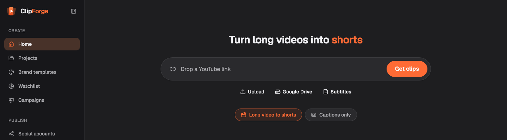
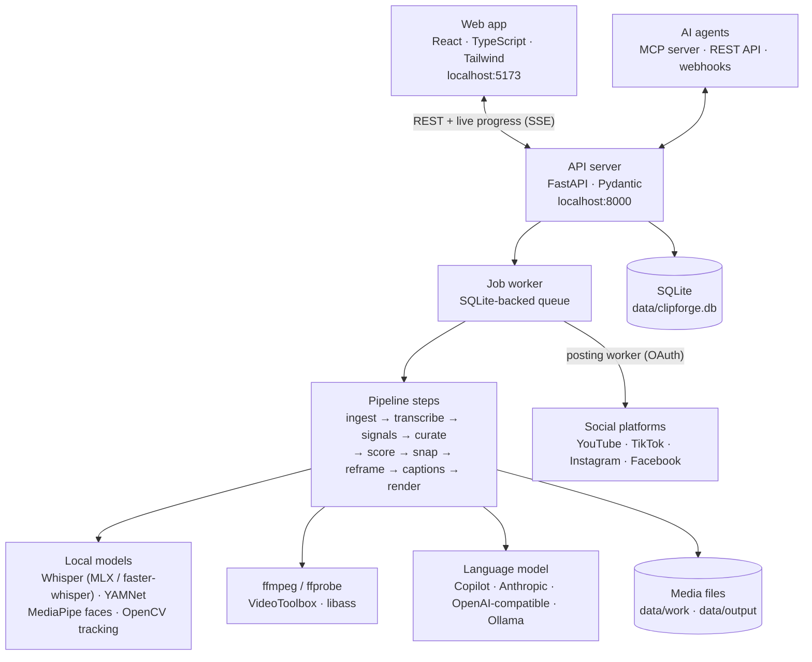

<p align="center">
  
</p>

<h1 align="center">ClipForge</h1>

<p align="center"><b>Turn long videos into short, captioned, ready-to-post clips — locally on your Mac.</b></p>

<p align="center">
  <a href="https://github.com/omairtemurian/clipforge/stargazers"></a>
  
  
  
  
</p>

<p align="center">
  
</p>

ClipForge turns a long video (a file or a YouTube link) into short, captioned,
scored clips, locally on your Mac. It transcribes with Whisper (on the Apple GPU
when available), listens for laughs and applause, asks a language model for the
best moments, scores them, reframes them to 9:16, 1:1, 4:5 or 16:9, burns in
animated captions and renders mp4 files with ffmpeg. A web app lets you pick
the clips, edit them and post them.

## How it works

```mermaid
flowchart LR
    subgraph IN["1 · Bring a video"]
        A1["YouTube link"]
        A2["Upload (up to 30 GB)"]
        A3["Google Drive · Dropbox<br/>inbox folder · watched channels"]
    end

    subgraph AN["2 · Understand it"]
        B1["Ingest<br/>H.264 · audio · thumbnail"]
        B2["Transcribe<br/>Whisper on the Apple GPU"]
        B3["Listen & look<br/>laughs · applause · energy<br/>scene cuts · faces"]
    end

    subgraph AI["3 · Find the moments"]
        C1["Language model picks clips<br/>hook · flow · value · trend"]
        C2["Score & rank<br/>virality score 0–99"]
        C3["Snap to words & pauses"]
    end

    subgraph MK["4 · Make the shorts"]
        D1["Reframe 9:16<br/>face & object tracking"]
        D2["Animated captions<br/>30+ styles · emojis"]
        D3["Polish<br/>fillers · zoom · music · loudness"]
        D4["Render mp4<br/>VideoToolbox"]
    end

    subgraph OUT["5 · Ship it"]
        E1["Edit in the browser"]
        E2["AI title · description · hashtags"]
        E3["Post or schedule<br/>YouTube · TikTok · Instagram · Facebook"]
    end

    IN --> B1 --> B2 --> B3 --> C1 --> C2 --> C3 --> D1 --> D2 --> D3 --> D4 --> E1 --> E2 --> E3
```



1. **Bring a video.** Paste a link, upload a file, or let ClipForge watch a
   YouTube channel or Twitch streamer and import new uploads by itself.
2. **Understand it.** The video is normalised to H.264, transcribed word by
   word (on the Apple GPU when available), and analysed for laughs, applause,
   energy peaks, scene cuts and faces.
3. **Find the moments.** A language model reads the timed transcript with the
   audio markers and proposes clips with a hook, flow, value and trend score
   and a reason. ClipForge validates, ranks and snaps every clip to clean word
   and pause boundaries.
4. **Make the shorts.** Each clip is reframed around the speaker (or a tracked
   object), gets animated captions, optional auto zoom, filler removal, music
   and loudness normalisation, and is rendered with the Mac's hardware encoder.
5. **Ship it.** Fine-tune in the editor, let the AI write the post text, then
   post or schedule to your connected accounts — you always make the final
   click.

### Architecture



Everything runs on your machine. The only outside calls are the language
model you choose, the platforms you connect, and the downloads you ask for.

## Features

- **AI clipping** — ranked clips with a virality score (hook, flow, value,
  trend) and the reason; prompt-to-clip ("find moments about…"), reprompting,
  topic chapters, and a captions-only mode.
- **Imports** — YouTube links, uploads up to 30 GB (resumable), Google Drive,
  Dropbox, a watched inbox folder, your own SRT/VTT, and auto-import from
  watched YouTube channels / Twitch streamers.
- **Reframe** — face and object tracking, click-to-track, per-scene layouts
  (fill, fit, square over blur, split, three-speaker grid, picture-in-picture,
  gameplay + facecam), automatic zoom-out moments and a calm, normal or fast
  camera motion (calm glides between subjects in smooth eased moves).
- **Captions** — 30+ original animated styles, 15+ open-license fonts, active
  word and keyword highlights, emojis, translation (incl. right-to-left),
  brand vocabulary and auto-censor.
- **Editor** — transcript editing, multi-track timeline, trim/split/duplicate,
  text overlays, transitions, hooks, headlines, motion graphics, music and SFX
  with auto-ducking, speech cleanup and noise removal, undo/redo and versions.
- **Posting** — sign in with YouTube, TikTok, Instagram and Facebook; AI-written
  titles, descriptions and hashtags; one-click post, scheduling, a calendar and
  a posting worker with retries. Publishing is always a human click.
- **Campaigns** — campaign rules and permission evidence, fresh-upload watch,
  presets, a rule checker before posting, and a tracker for what you submitted,
  what was approved and what you were paid.
- **Autopilot** — new uploads of a watched channel become draft clips that wait
  in the Approval inbox; nothing is queued until you approve it.
- **Pro Edit** — an opt-in, heavily edited variant of a clip (6 original
  presets, 4 intensities): zooms, SFX, kinetic captions, grades, music and an
  AI critic, with a side-by-side editor and style recipes learned from links.
- **Automation** — public REST API (`/api/docs`), signed webhooks and an MCP
  server so AI agents (Hermes, Claude, Copilot) can do everything up to drafts.
- **Private by design** — runs on your machine; no accounts, no telemetry.

## Quick start

```sh
brew install ffmpeg-full uv node tesseract   # once (tesseract: optional)
git clone <this repo> clipforge && cd clipforge
make setup                         # Python + Node packages, local models
cp .env.example .env.local         # then pick your language model (below)
make dev                           # API :8000 + web app :5173
```

Open <http://localhost:5173>, paste a YouTube link or upload a video, choose
the clip settings and press **Get clips**. Details for every step follow.

## How to use

1. **Home** — paste a link, upload, or import from Google Drive. Pick *Long
   video to shorts* (AI clipping) or *Captions only* (the whole video as one
   captioned clip).
2. **Settings panel** — genre, clip lengths, number of clips, timeframe,
   caption style, aspect ratio, "find moments about…", auto zoom/cut/headline,
   language. Press **Get clips**.
3. **Projects** — each project shows its progress; open it when it is ready.
4. **Clips gallery** — clips sorted by score with the reason; preview on
   hover, download, remove, or open the editor (scissors).
5. **Editor** — cut words from the transcript, drag the trim handles, change
   captions, layout and reframe per scene, add text, music and transitions,
   then **Render**.
6. **Post** — connect accounts under **Social accounts** (Sign in with
   Google / TikTok / Instagram / Facebook), then **Post** or **Schedule** from
   a clip. The AI fills in the title, description and hashtags; you review and
   click.
7. **Campaigns** — create a campaign (rules, rate, permission evidence), put
   projects in it and check the rules before posting; see
   [Campaigns and autopilot](#campaigns-and-autopilot).
8. **Approve** — with autopilot on, review drafts in **Post → Approval inbox**
   (keys A, R, E, J, K) and tick posts submitted in **Ready to submit**.
9. **Automate** — create an API key under Settings and connect an AI agent
   over MCP ([docs/mcp.md](docs/mcp.md)) or the REST API
   ([docs/public-api.md](docs/public-api.md)).

## Requirements

- macOS on Apple silicon (the setup below is tested on arm64).
- [Homebrew](https://brew.sh), [uv](https://docs.astral.sh/uv/) (installs
  Python 3.11 for you) and Node.js 24 with npm.
- ffmpeg **with libass** (the captions are burned in with the `subtitles`
  filter). Plain `brew install ffmpeg` has no libass; use the keg-only
  `ffmpeg-full`, which ClipForge finds on its own:

  ```sh
  brew install ffmpeg-full
  ```

- Optional: [Tesseract](https://github.com/tesseract-ocr/tesseract)
  (`brew install tesseract`) to read the burned-in captions of Pro Edit
  style references; without it a style recipe has no caption features.

- About 1 GB of disk for the local models.
- A language model (see [Language model](#language-model)): your GitHub
  Copilot account (the default), an Anthropic API key, a Claude subscription
  (through Claude Code), an OpenAI-compatible API key, or Ollama.

## Setup

```sh
make setup
```

`make setup` runs `uv sync` (Python packages), `scripts/download_models.py`
(the whisper model, YAMNet, the face detector and the RNNoise speech model
into `models/`, with a
progress bar; models already there are skipped), `npm ci` for the frontend and
for the end-to-end tests, and `npx playwright install chromium`. Run the model
download alone, or with another whisper model, with:

```sh
uv run python scripts/download_models.py --whisper-model small
```

## Language model

Defaults live in `config.yaml`. Secrets go in `.env.local` (or `.env`), which
git ignores. Copy the template and edit it:

```sh
cp .env.example .env.local
```

Pick one provider with `LLM_PROVIDER`:

| `LLM_PROVIDER` | Needs                                                                         |
| -------------- | ----------------------------------------------------------------------------- |
| `copilot`      | `GITHUB_COPILOT_TOKEN`, or `gh auth login -h github.com` as `COPILOT_ACCOUNT` |
| `openai`       | `OPENAI_API_KEY`, and `OPENAI_BASE_URL` for a compatible server               |
| `ollama`       | a running Ollama server at `OLLAMA_HOST` and the model pulled                 |
| `anthropic`    | `ANTHROPIC_API_KEY` (console.anthropic.com), model in `ANTHROPIC_MODEL`       |
| `claude_code`  | Claude Code installed and logged in (`claude`), model in `CLAUDE_CODE_MODEL`  |

`LLM_MODEL` is the model name for the provider (default `claude-sonnet-5.5`
on Copilot, or `gpt-6-luna`; for Ollama, for example `llama3.1`, after
`ollama pull llama3.1`). `COPILOT_ACCOUNT` (default empty: gh's active account) is
the GitHub CLI account whose token Copilot uses when `GITHUB_COPILOT_TOKEN` is
empty; the models Copilot offers depend on the account. The same settings can
be edited and tested in the app, on the Settings page.

With `anthropic`, the model is `ANTHROPIC_MODEL` (default `claude-sonnet-5-5`;
`LLM_MODEL` is not used), sent to `ANTHROPIC_BASE_URL` (default
`https://api.anthropic.com`). On the Settings page, "Load models" lists the
models the key can use.

With `claude_code`, each request runs `claude -p` (the Claude Code CLI,
`CLAUDE_CODE_BIN`, default `claude`) with your Claude subscription; no key is
stored. The model is `CLAUDE_CODE_MODEL` (default `sonnet`; also `opus`,
`fable` or a full id). If Test connection says Claude Code is not logged in,
run `claude` in a terminal, log in, and retry. See
[Engine: claude-code](#engine-claude-code).

The GitHub Models API (`models.github.ai`) was retired on 2026-07-30, so it is
not a provider. A GitHub account is used through Copilot instead.

Other `.env` values (all optional): `HF_TOKEN` for gated Hugging Face
downloads, `FFMPEG_BIN` and `FFPROBE_BIN` to use other ffmpeg binaries, and
`YTDLP_COOKIES_FROM_BROWSER` (for example `chrome`) or `YTDLP_COOKIES_FILE`
for YouTube videos that need a signed-in session.

Jobs run in a worker pool: `WORKERS` threads (default 2). In `config.yaml`,
`job_concurrency` caps the running jobs of each kind (default one `process`
and two `render` jobs) and `gpu_job_kinds` lists the GPU-heavy kinds, of
which only one job runs at a time. A queued job with a higher `priority`
runs first. A job that was running when the app stopped is queued again on
the next start and resumes after its last finished step; one that was
started `job_max_attempts` times (default 3) fails instead.

## Optional engines

Heavy AI features run as optional engines. None is needed for the core app:
a feature whose engine is missing shows "Not installed — see setup" with a
link to its section below instead of failing. Settings lists every engine
with its install state and version (`GET /api/engines`; the check is cached,
press **Check again** after an install). Install the Python packages into the
project's environment:

```sh
uv pip install --python .venv/bin/python <package>
```

`uv sync` removes packages that are not in `uv.lock`, so run the installs
again after `make setup`. `make check-engines` runs the tests of the engines
that are installed; a missing engine is skipped with the reason.

Each section below has **Install** (what to run) and **Install check** (what
ClipForge looks at to call the engine installed; the check only looks, it
never runs the engine). After installing, press **Check again** in Settings
or run `curl 'http://127.0.0.1:8000/api/engines?refresh=true'`: the engine
shows `"installed": true`, or the `error` says what is still missing.
Five engines (demucs, image-gen, realesrgan, voice-clone, embeddings) belong
to features that are not planned (dubbing, AI image B-roll, upscaling, topic
search): no screen uses them, they are only listed so the check works.

### Engine: ollama-vlm

A local vision-language model that describes video frames.

**Install:** install Ollama (`brew install ollama`), start it (`ollama serve`)
and pull a model that has the `vision` capability (`ollama show <model>`
lists it).

**Install check:** the Ollama server answers at `OLLAMA_HOST`, has a model
with the vision capability, and `VLM_MODEL` (when set) is one of them.

`OLLAMA_HOST` sets the server address; `VLM_MODEL` picks the model (empty:
the first vision model
`ollama list` shows) and `FRAME_CAPTION_INTERVAL_S` (default 10) how often a
frame is captioned besides each scene cut. Checked on macOS arm64 with
`qwen3.5-35b-128k` (Ollama 0.34.4). The captions are used by projects with
"Clip anything" on (settings panel); without this engine clip anything still
reads motion, audio events and scene cuts.

### Engine: deepfilternet

Speech enhancement (noise reduction, voice isolation) with DeepFilterNet3,
run by the official `deep-filter` 0.5.6 program (MIT or Apache-2.0; no
Python packages). On a Mac, `uv run python scripts/download_models.py
--deepfilternet` downloads it (28 MB, sha256-pinned) into
`models/deepfilternet`. Elsewhere put a `deep-filter` from the
[DeepFilterNet releases](https://github.com/Rikorose/DeepFilterNet/releases/tag/v0.5.6)
on your PATH or set `DEEP_FILTER_BIN` to it. Do not install the pip package
`deepfilternet` 0.5.6: it needs numpy<2 and fails to import with current
torchaudio (`No module named 'torchaudio.backend'`). Without the engine,
speech enhancement uses ffmpeg's arnndn/afftdn filters.

**Install check:** `deep-filter` is found (`DEEP_FILTER_BIN` if set, else
`models/deepfilternet`, else PATH) and answers `--version`.

### Engine: kokoro

Local AI voiceover with Kokoro-82M (Apache-2.0; 42 voices in American and
British English, Spanish, French, Hindi, Italian and Brazilian Portuguese).

**Install:** `uv pip install --python .venv/bin/python kokoro-onnx` (MIT; it
pulls in phonemizer and espeak-ng, both GPL-3.0), then
`uv run python scripts/download_models.py --kokoro` puts the pinned model and
voices files (about 350 MB) in `models/kokoro`. `make setup` (`uv sync`)
removes the package again: install it after setup.

**Install check:** the `kokoro_onnx` package is importable and the model and
voices files are in `models/kokoro`.

### Engine: piper

Local AI voiceover with Piper.

**Install:** `uv tool install piper-tts` puts `piper` on your
PATH (GPL-3.0-or-later, run as a separate program; or set `PIPER_BIN`), then
`uv run python scripts/download_models.py --piper` puts the default voice
`en_US-ljspeech-medium` (LJ Speech, public domain) in `models/piper`. Any other
voice from [rhasspy/piper-voices](https://huggingface.co/rhasspy/piper-voices)
(`<name>.onnx` + `<name>.onnx.json`, and its `MODEL_CARD` saved as
`<name>.MODEL_CARD` for the license) put there is listed too.

**Install check:** `piper` (or `PIPER_BIN`) is on PATH and `models/piper` has
at least one voice (`.onnx` + `.onnx.json`).

### Engine: demucs

Source separation (voice and background); no screen uses it (dubbing is not
planned).

**Install:** `uv pip install --python .venv/bin/python demucs` (MIT; it
installs PyTorch).

**Install check:** the `demucs` package is importable.

### Engine: image-gen

AI image B-roll on Apple Silicon with MFLUX; not planned, no screen uses it.

**Install:** `uv pip install --python .venv/bin/python mflux` (MIT; Python
3.11 or newer). Model weights are downloaded on first use.

**Install check:** the `mflux` package is importable.

### Engine: realesrgan

AI upscaling; not planned, no screen uses it.

**Install:** download the macOS build of
[Real-ESRGAN-ncnn-vulkan](https://github.com/xinntao/Real-ESRGAN-ncnn-vulkan/releases)
and put `realesrgan-ncnn-vulkan` on your PATH.

**Install check:** `realesrgan-ncnn-vulkan` is on PATH.

### Engine: voice-clone

Voice cloning with Coqui TTS; not planned (dubbing), no screen uses it.

**Install:** `uv pip install --python .venv/bin/python coqui-tts` (the code is
MPL-2.0; the model weights have their own license, check it before use). Only
clone a voice with its owner's consent.

**Install check:** the `TTS` package (coqui-tts) is importable.

### Engine: yamnet

Laugh and applause detection.

**Install:** `make setup` downloads the model into `models/yamnet`; to fetch
only the models run `uv run python scripts/download_models.py`.

**Install check:** the YAMNet model files are in `models/yamnet`.

### Engine: segment

Pro Edit's subject cut-out: the subject in front of overlays and captions,
the background blurred or swapped for a color (Pro Edit dialog, "Subject
cut-out"). Without it those options are skipped and the job log says why.

**Install:** `make setup` downloads MediaPipe's SelfieSegmenter model
(Apache-2.0, 250 KB) into `models/segment`; to fetch only the models run
`uv run python scripts/download_models.py`. The `mediapipe` package is a
normal dependency.

**Install check:** `mediapipe` is importable and
`models/segment/selfie_segmenter.tflite` exists.

### Engine: embeddings

Text embeddings for topic search; not planned, no screen uses it.

**Install:** `uv pip install --python .venv/bin/python sentence-transformers`
(Apache-2.0; it installs PyTorch).

**Install check:** the `sentence_transformers` package is importable.

### Engine: claude-code

The Claude Code CLI, used by `LLM_PROVIDER=claude_code` to pick clips with a
Claude subscription instead of an API key.

**Install:** follow https://code.claude.com/docs/en/setup, run `claude` once
in a terminal and log in. `CLAUDE_CODE_BIN` names the program (default
`claude` on PATH).

**Install check:** `<CLAUDE_CODE_BIN> --version` answers. Being logged in
shows only on a real request (Settings → Test connection).

## Run the app

```sh
make dev
```

This starts the API at <http://127.0.0.1:8000> and the web app at
<http://localhost:5173>. Open the web app, upload a video or paste a link,
choose the clip settings and press **Get clips**. Open a clip to edit it, then
**Render** and **Download**. A project can also be downloaded as a zip with the
mp4, SRT and metadata of every rendered clip. Stop both servers with Ctrl+C.

### Inbox folder

Set `INBOX_DIR=/path/to/folder` in `.env.local` (and optionally
`INBOX_POLL_S`, default 10 seconds) to import videos by dropping them into
that folder: a video file (mp4, mov, mkv, webm...) whose size has not
changed between two polls becomes a project with the default clip settings.
Each file is imported once; the file in the folder is left as it is.

### Watchlist (YouTube channels and Twitch streamers)

The **Watchlist** (sidebar; `/auto-import` redirects there) watches
creators so you can clip them first. Each new upload of a watched YouTube
channel becomes a top-priority project with the channel's saved settings,
source rights and credit line, and a Twitch go-live raises an alert. Every
alert shows as a toast on any page, in **Recent alerts** with the time from
publish to detection, and as a desktop notification once you press
**Enable desktop alerts**. Clipping a creator still needs their permission
or campaign terms before you publish.

- **YouTube channel**: paste a channel id (`UC...`), a
  `youtube.com/channel/UC...` link, or an `@handle` (handles are looked up
  with the YouTube Data API and need `YOUTUBE_API_KEY`), choose why you may
  use its videos and press **Watch channel**. Each card shows how the
  channel is watched (**Push**, **Push pending** or **Polling every N s**),
  when its feed was last read, the projects its new videos became and the
  last error; **Edit defaults** changes its settings, the switch pauses it
  and the bin stops watching it (its projects stay). The videos already in
  the feed when a channel is added are not imported; each new video is
  imported once.
- **Twitch streamer**: enter a login or `twitch.tv/...` link and press
  **Watch streamer**; the card shows **Live now** or when the streamer was
  last live. Twitch needs an app: register one at
  <https://dev.twitch.tv/console> and set `TWITCH_CLIENT_ID` and
  `TWITCH_CLIENT_SECRET` in `.env.local`. Without them the streamers are
  kept but not checked ("Needs Twitch app keys").

Without a public URL every feed and streamer is polled every
`AUTO_IMPORT_POLL_S` seconds (default 60, minimum 30) with conditional
requests, jitter and backoff on errors. For alerts within seconds set
`PUBLIC_CALLBACK_URL` to an HTTPS address that reaches the API
(`http://127.0.0.1:8000`): ClipForge then subscribes each channel at
YouTube's WebSub hub and each streamer to Twitch EventSub `stream.online`,
and keeps a safety poll every 15 minutes. This is optional. One way is a
[Cloudflare named tunnel](https://developers.cloudflare.com/cloudflare-one/networks/connectors/cloudflare-tunnel/)
whose ingress only lets the two callback paths through (cloudflared
forwards the path unchanged, so the rule is anchored at both ends):

```yaml
tunnel: <tunnel-uuid>
credentials-file: /path/to/<tunnel-uuid>.json
ingress:
  - hostname: clipforge.example.com
    path: ^/api/watch/(websub/UC[A-Za-z0-9_-]{22}|twitch/eventsub)$
    service: http://127.0.0.1:8000
  - service: http_status:404
```

and `PUBLIC_CALLBACK_URL=https://clipforge.example.com` in `.env.local`.
Pushed notifications are checked against a per-topic HMAC secret derived
from `data/watch_secret.key` (mode 0600); unsigned or wrongly signed ones
are refused.

### Google Drive import

The **Google Drive** button on Home imports a video from your Drive by its
link (Share → Copy link). It needs a Google OAuth client of your own:

1. In the [Google Cloud console](https://console.cloud.google.com/), create a
   project, enable the **Google Drive API** and configure the OAuth consent
   screen (add yourself as a test user while the app is in testing).
2. Create an OAuth client ID of type **Desktop app**.
3. Put its values in `.env.local` and restart ClipForge:

   ```sh
   GOOGLE_OAUTH_CLIENT_ID=1234-abc.apps.googleusercontent.com
   GOOGLE_OAUTH_CLIENT_SECRET=GOCSPX-...
   ```

4. Open the Google Drive dialog and press **Connect Google Drive**; finish
   the Google consent in the window that opens.

ClipForge asks for the `drive.readonly` scope (read and download your Drive
files; Google lists it as restricted, so a public app would need Google's
verification) and redirects back to the local API
(`http://127.0.0.1:8000/api/sources/gdrive/callback`, a loopback address that
Desktop app clients accept on any port). The tokens are stored encrypted in
`data/oauth_tokens/` (owner-readable only; the key is derived from
`data/watch_secret.key`, so deleting that file means connecting again);
**Disconnect** forgets them
(revoke the access at <https://myaccount.google.com/permissions>). Without
the client ID the dialog says "Google Drive needs credentials" and the API
answers 412. Public Drive links still work as plain links in the link box
without connecting.

### Dropbox import (optional)

ClipForge can also download a video from a Dropbox **shared link** (Share →
Copy link). There is no button on Home yet: use the API
(`/api/sources/dropbox/*`, see `/api/docs`). It needs a Dropbox app of your
own:

1. In the [Dropbox App Console](https://www.dropbox.com/developers/apps)
   create an app (Scoped access, **Full Dropbox**) and on the Permissions
   tab enable `sharing.read`.
2. On the Settings tab add the redirect URI
   `http://127.0.0.1:8000/api/sources/dropbox/callback` (exactly).
3. Put the **App key** in `.env.local` and restart ClipForge (the App secret
   is not used):

   ```sh
   DROPBOX_APP_KEY=abc123...
   ```

4. `curl -X POST http://127.0.0.1:8000/api/sources/dropbox/connect` returns
   an `authorize_url`: open it and approve. Then
   `POST /api/sources/dropbox/import` with `{"file": "<shared link>"}`
   creates the project; `DELETE /api/sources/dropbox/connection` forgets
   the token.

Folder links are refused. Without the app key the endpoints answer 412
`needs_credentials`, and Dropbox links go to yt-dlp as plain links.

### Social accounts

The sidebar's **Publish → Social accounts** page lists the accounts you
connected for publishing (filter by platform; **Remove** forgets the account
and its token and is refused while it has posts waiting to go out). **Add
account** opens the "Social account connections" window: a tile per
platform whose **Add account** button opens that platform's sign-in in a new
tab (the page notices the new account by itself). A platform whose developer
app keys are missing shows "Needs developer app keys" with the variable
names to set in `.env.local` instead of a button; the page's **Developer
apps** section shows the same for every platform. Each account shows its
platform's restrictions (unaudited app, daily caps, ...) as badges.

### Posting worker

While the backend runs (`make dev` or uvicorn; the browser can be closed)
the posting worker publishes the queued posts whose time has come, checking
every `post_poll_s` seconds (default 30). Posts due while the app was off
(their time passed more than `post_missed_grace_s`, default 600 s, before
the start and they were never tried) go out late on the next start, or are
marked **Skipped** when Settings → Posting → "Posts missed while ClipForge
was off" is "Skip them" (`post_missed_policy: skip`); a skipped post can
still be sent with "Post now" in its details. Before each upload it applies:

- **Quota guard**: a post that would go over a platform's daily API quota
  (YouTube uploads) waits for the quota to reset; no attempt is counted.
- **Rate limits**: an account starts at most one upload per
  `post_account_gap_s` seconds (default 60) and its platform's daily post
  cap per 24 hours (YouTube 100, TikTok 15, Instagram 100, Facebook 30);
  `post_platform_hourly` (e.g. `{tiktok: 10}`) caps a platform's uploads per
  hour over all accounts. A held post shows when it will be tried.
- **Retries**: a passing failure (rate limit, server error, network) is
  retried after `post_retry_base_s` seconds (default 60), doubling each time
  up to `post_retry_max_s` (default 3600); the `post_max_attempts`-th failed
  upload (default 5) fails the post with the platform's error. Queuing a
  failed post again starts its attempts over.

A post that cannot go out yet (no source rights, clip not rendered,
platform keys missing) stays queued with the reason and is looked at again
after `post_retry_max_s`. A post that was uploading when the app stopped
is marked failed on the next start (the platform may already have it:
check before posting it again).

**Post history** (sidebar → Post → Post history, `GET /api/posts/history`)
lists the published posts with links to the live posts, and the failed and
skipped ones with the reason, newest first, filtered by status.

### YouTube publishing

**Developer app setup.** ClipForge uploads clips to your YouTube channels with
the same Google OAuth client as the Drive import (`GOOGLE_OAUTH_CLIENT_ID` and
`GOOGLE_OAUTH_CLIENT_SECRET`): also enable the **YouTube Data API v3** in
that Google Cloud project. Connecting a channel
(`POST /api/accounts/youtube/connect`) asks for the `youtube.upload` and
`youtube.readonly` scopes and shows Google's account chooser each time, so
you can connect several channels. Without the client ID the connect call
answers 412 `needs_credentials`. Official docs:
[OAuth 2.0 for desktop apps](https://developers.google.com/identity/protocols/oauth2/native-app),
[`videos.insert`](https://developers.google.com/youtube/v3/docs/videos/insert).

A YouTube post's settings are its title (up to 100 characters), description,
tags, category (default `22`, People & Blogs), privacy
(`public`/`unlisted`/`private`), made for kids, altered or synthetic media
and notify subscribers; title, description and tags default to the clip's.
The posting worker uploads a post when its time comes; a public post
uploaded before its time would go up private with YouTube's `publishAt`. Videos go up in resumable
8 MiB chunks; an interrupted chunk resumes where YouTube stopped, and a
quota, rate limit or server error puts the post back in the queue. A custom
thumbnail is set after the upload (your channel must be verified for custom
thumbnails; a failed thumbnail leaves the video published).

**Review notes.** Your Google Cloud project has daily quotas that reset at midnight Pacific
Time: 100 uploads and 10,000 units for the other calls (a channel lookup
costs 1, a thumbnail 50). ClipForge counts them and holds posts back before
they are used up; if Google gave your project more, set
`YOUTUBE_DAILY_UPLOADS` and `YOUTUBE_DAILY_QUOTA_UNITS` in `.env.local`.
Raising the quota needs YouTube's quota extension form and its API
compliance audit, and until the project is audited YouTube may keep public
uploads private. Official docs:
[quota costs](https://developers.google.com/youtube/v3/determine_quota_cost),
[quota and compliance audits](https://developers.google.com/youtube/v3/guides/quota_and_compliance_audits).

### TikTok publishing

**Developer app setup.** ClipForge posts clips to TikTok with the Content
Posting API (Direct Post). Create an app on https://developers.tiktok.com, add **Login Kit** (Desktop)
with the redirect URI `http://127.0.0.1:8000/api/accounts/tiktok/callback`
(TikTok accepts any port on localhost/127.0.0.1 for desktop apps) and the
**Content Posting API** with Direct Post enabled, request the
`user.info.basic` and `video.publish` scopes, and set `TIKTOK_CLIENT_KEY`
and `TIKTOK_CLIENT_SECRET` in `.env.local`. Without them
`POST /api/accounts/tiktok/connect` answers 412 `needs_credentials`.
Official docs:
[Content Posting API: get started](https://developers.tiktok.com/doc/content-posting-api-get-started),
[Direct Post reference](https://developers.tiktok.com/doc/content-posting-api-reference-direct-post),
[Login Kit for desktop](https://developers.tiktok.com/doc/login-kit-desktop).

Before each post ClipForge asks TikTok what the account allows (privacy
levels, longest video, comments/Duet/Stitch) and refuses settings it does
not allow. A TikTok post's settings are its caption (up to 2200
characters; default the clip's title and hashtags), who can see it (no
default: you must choose), comments/Duet/Stitch (off unless you turn them
on), the commercial content disclosure (your brand / branded content,
which cannot be "only me"), the AI-generated label and the cover frame
time. Videos (MP4, MOV or WebM, up to 4 GB) go up in 10 MiB chunks; rate
limits and server errors put the post back in the queue.

**Review notes.** Until TikTok audits your app, posts can only be private ("only me") and
only to private accounts, for up to 5 users a day; TikTok's audit does not
accept tools that only post to your own accounts. Each account can post
about 15 times a day through apps. TikTok's rules for what an app may show
and ask before posting are in its
[content sharing guidelines](https://developers.tiktok.com/doc/content-sharing-guidelines).

### Instagram publishing

**Developer app setup.** ClipForge posts clips as Reels to Instagram
professional accounts (Business or Creator) linked to a Facebook Page, with the Instagram API
with Facebook Login for Business (the only Instagram API that takes a video
file from your computer). Create a Business app on
https://developers.facebook.com, add **Facebook Login for Business** with
the redirect URI `http://127.0.0.1:8000/api/accounts/instagram/callback`
(Meta accepts localhost redirects while the app is in Development mode)
and the **Instagram** product, and set `META_APP_ID` and `META_APP_SECRET`
in `.env.local` (optionally `META_LOGIN_CONFIG_ID`, a Facebook Login for
Business configuration with the permissions below). Sign in with
`instagram_basic`, `instagram_content_publish`, `pages_show_list` and
`pages_read_engagement`. Without the keys
`POST /api/accounts/instagram/connect` answers 412 `needs_credentials`.
Official docs:
[create an app](https://developers.facebook.com/docs/development/create-an-app),
[Facebook Login for Business](https://developers.facebook.com/docs/facebook-login/facebook-login-for-business),
[Instagram content publishing](https://developers.facebook.com/docs/instagram-platform/instagram-api-with-facebook-login/content-publishing).

ClipForge keeps a long-lived (about 60 days) token and renews it while it
is valid; after that you connect the account again. An Instagram post's
settings are its caption (up to 2200 characters, 30 hashtags and 20 @
tags; default the clip's title and hashtags), sharing to the feed,
up to 3 collaborators, the cover frame time (Instagram takes no cover file
from your computer), the original audio name, the AI-generated label and
trial reels (shown to non-followers first). Reels are MP4 or MOV, 3 s to 15
min, up to 300 MB. Instagram allows 100 API posts per account per 24 h:
ClipForge checks the limit before each post and puts the post back in the
queue when it is used up, rate-limited or Instagram has a server error.

**Review notes.** Until Meta's App Review grants Advanced Access (with
Business Verification), the app can only post for people who have a role on it
(e.g. your own accounts as the app's admin). See Meta's
[App Review](https://developers.facebook.com/docs/resp-plat-initiatives/app-review)
guide.

### Facebook publishing

**Developer app setup.** ClipForge posts clips as Reels to a Facebook Page you
manage, through the same Meta app as Instagram (`META_APP_ID`, `META_APP_SECRET`, optionally
`META_LOGIN_CONFIG_ID`). Add the redirect URI
`http://127.0.0.1:8000/api/accounts/facebook/callback` to **Facebook Login
for Business** and sign in with `pages_show_list`, `pages_read_engagement`
and `pages_manage_posts`; you need the Page task "Create content". Without
the keys `POST /api/accounts/facebook/connect` answers 412
`needs_credentials`. Choose a single Page in Facebook's permission dialog:
ClipForge connects the first Page you can post on and names the others in
the account's restrictions. Official docs:
[Reels publishing](https://developers.facebook.com/docs/video-api/guides/reels-publishing),
[Facebook Login for Business](https://developers.facebook.com/docs/facebook-login/facebook-login-for-business).

A Facebook post's settings are its description (default the clip's title
and hashtags), an optional title, the AI-generated label and up to 10
collaborator Pages. Reels are vertical (9:16) MP4 files of 3 to 90 s, at
least 540x960, 24 to 60 fps. Facebook allows 30 API reels per Page per 24 h
and does not report the count: ClipForge cannot check it beforehand and
puts the post back in the queue when Facebook rate-limits it or has a server
error.

**Review notes.** Without App Review (Advanced Access, with Business
Verification) only people with a role on your Meta app can post; see Meta's
[App Review](https://developers.facebook.com/docs/resp-plat-initiatives/app-review)
guide.

### Campaigns and autopilot

The sidebar's **Campaigns** page holds your clipping campaigns: the rules
(allowed platforms, clip length, required hashtags and credit line), the
rate per 1,000 views, the creator channels to watch and the permission
evidence (a link and a screenshot). A project put in a campaign gets its
presets, and the editor's **Rules** panel and the posting worker check the
clip against the rules before it can go out. ClipForge never scrapes or
automates a campaign board: you copy the post details (**Copy for
submission**), submit them yourself and tick the post as submitted. The
**Submissions** section tracks each post's status, views and payout, and
shows the estimated earnings (approved views × rate ÷ 1,000) next to the
payouts you entered. **Post → Ready to submit** lists the published posts of
all campaigns that are not yet submitted.

**Autopilot** makes drafts for you, never posts. Set it up per campaign
(`GET`/`PUT /api/campaigns/{id}/autopilot`: on/off, clips per source, posts a
day (at most 5), the posting slots, the accounts and when a draft expires;
defaults: off, 3 clips per source, 3 posts a day, 3 days). While it is on,
Auto Import (the [Watchlist](#watchlist-youtube-channels-and-twitch-streamers)
with the campaign's channels) turns each new upload into a project; its best
clips that pass the rules become drafts in **Post → Approval inbox**. There
you **Approve** (the clip is queued in the next free slot of the campaign's
accounts), **Edit**, or **Reject** with a reason; keys A, R, E, J and K work.
Only a person can approve or reject: an API key or an agent gets 403
`human_only`. The autopilot stops by itself, with a notification, when you
pause it (`PUT /api/autopilot/pause`; an agent may pause but only you can
resume), the campaign is paused or ended, the permission evidence is
missing, or 3 uploads in a row fail. A daily digest (Settings →
Notifications, `digest_time`, default 08:00, empty = off) says how many
drafts wait, what was posted and what is left to submit.

### Pro Edit

Pro Edit makes a second, heavily edited version of a clip, the way a pro
short-form editor would. It is opt-in and never touches the original: the
result is a new variant clip, "<title> — Pro Edit", next to the original in
the gallery and the inbox. Turn it off with `proedit.enabled: false` in
`config.yaml` (no Pro Edit entry in the app, its endpoints answer 404).

- **Start** — in the clips gallery or the editor press **Pro Edit**. Pick a
  preset — **Clean Pro**, **Dark Edit**, **Phonk Edit**, **Cinematic**,
  **Skull Moment** or **Glitch** (all original) — and an intensity: Clean,
  Standard, Pro or Extreme (higher means more zooms, effects and SFX per
  second). Options: a style recipe, a music bed from the audio library, the
  AI critic (with its cost estimate), a loop ending and a subject cut-out
  (needs the [segment engine](#engine-segment)).
- **Progress** — the steps show live: Plan, Proxy, Critic round n/2 and
  Final render. A Director (your language model, or a rule-based director
  when none is set) writes an edit decision list (EDL); ClipForge renders a
  540p proxy, the critic scores it and revises the EDL, then the final
  renders at the source resolution.
- **Editor** — `/clips/<id>/proedit` shows the original and the Pro Edit
  side by side, the EDL as lanes (zoom, fx, grade, overlay, captions, sfx,
  music, audio fx) and an inspector for the selected item. Drag or resize
  items, add or delete them, regenerate one item or the whole plan, run the
  critic again, reset, or go back to an earlier plan version. Each change
  saves a new plan version; **Render plan vN** renders it.
- **Style recipes** — on `/proedit/style-recipes` (**Manage style
  recipes** in the Pro Edit dialog) give up to 5 links to edits you like and
  confirm you have the rights to analyze them. ClipForge downloads each one
  (at most 3 minutes, 720p), measures its pacing, zooms, grade, captions and
  audio, and deletes the media at once; only the numbers are kept. Tune the
  sliders, export or import a recipe as JSON, and apply it in the Pro Edit
  dialog. A Pro Edit made with a recipe shows a style-match score (0–100)
  and which metrics differ.
- **Audio library** — sound effects and music come from the starter set,
  your own uploads, [Freesound](https://freesound.org) (set
  `FREESOUND_API_KEY` in `.env.local`; only CC0 and CC-BY sounds, with
  attribution) and Pixabay (no audio API: download the file yourself and
  import it with its page link). The credits needed for a clip are written
  into its post description.
- **Campaigns and autopilot** — a campaign's **Pro Edit** panel has
  **Heavy edits allowed** (`allow_heavy_edits`) and **Also make a Pro Edit
  variant** (default off). With both on, autopilot drafts a Pro Edit next to
  each draft clip; in the Approval inbox you approve the original, the Pro
  Edit or both.
- **Cost** — the critic is a vision model; other models run the Director
  only. Set `proedit.usd_per_million_tokens` (your model's price) and
  optionally `proedit.monthly_cap_usd` to stop new Director and critic calls
  for the month once the cap is reached. `critic_threshold`,
  `critic_max_frames` and `critic_max_rounds` (0 turns it off) tune the
  critic.

Known limits: the critic's live vision model and the Freesound download
have not been run against the real services here (tests use recorded
replies); Cinematic has no letterbox; the cut-out "swap" background is a
solid color; there is no B-roll move. See [docs/parity.md](docs/parity.md)
for the full v3 coverage.

### Public API

Scripts and AI agents use the REST API at `http://127.0.0.1:8000/api/v1`
with an API key (`X-API-Key: <key>` or `Authorization: Bearer <key>`). Make
a key with `POST /api/api-keys` (`{"name": "n8n"}`): it is shown once and
only its hash is stored. The OpenAPI docs are at `/api/docs`. A key may send
`api_rate_limit_per_min` requests a minute (default 120, then 429). Agents
can do everything up to drafts and draft schedules; queueing and publishing
posts are only for you, in the app (403 for a key). See
[docs/public-api.md](docs/public-api.md) for the automation loop and an
example agent prompt.

### MCP server

`clipforge-mcp` gives an AI agent (Claude, Copilot, any MCP client) the same
operations as MCP tools, over stdio, with an API key in `CLIPFORGE_API_KEY`:
`uv run clipforge-mcp` while ClipForge runs. Agents can draft and schedule
drafts; there is no tool to queue or publish. See [docs/mcp.md](docs/mcp.md)
for the client setup, the tools and an example agent prompt.

### Webhooks

ClipForge can POST `project.completed`, `clip.rendered`, `post.published`
and `post.failed` to your own address (n8n, Zapier, a script). Register one
with `POST /api/webhooks` (`{"url": "...", "events": [...]}`); the answer
holds the signing secret, shown once. Each request carries an
`X-ClipForge-Signature` (HMAC-SHA256), failed deliveries are retried with
backoff, and `GET /api/webhooks/{id}/deliveries` is the log. See
[docs/automation.md](docs/automation.md) and the example workflow
[examples/n8n-clipforge.json](examples/n8n-clipforge.json).

## Command line

The same pipeline runs without the app. The clips and their `.srt` and
`.json` files are written to `data/output/<job_id>/`, the intermediate files
to `data/work/<job_id>/`, and the command prints the path of each clip:

```sh
uv run clipforge run path/to/video.mp4
uv run clipforge run "https://www.youtube.com/watch?v=VIDEO_ID" --genre podcast
uv run clipforge run talk.mp4 --aspect 1:1 --num-clips 5
uv run clipforge run talk.mp4 --aspect 4:5   # or any custom W:H, 1:4 to 4:1
```

Run one step again for an existing job (`ingest`, `transcribe`, `signals`,
`enrich`, `curate`, `score` or `snap`); `--force` redoes it even if its output
exists. The command prints the path of the step's output:

```sh
uv run clipforge step curate 1 --force
```

To try ClipForge without whisper or a language model, use the test fixture
(a transcript and an LLM reply recorded in `backend/tests/fixtures/`):

```sh
CLIPFORGE_TEST_MODE=1 uv run clipforge run backend/tests/fixtures/sample.mp4 \
  --fixtures-dir backend/tests/fixtures --num-clips 2
```

## Development

```sh
make test    # backend (pytest) and frontend (Vitest) tests
make lint    # ruff, mypy --strict, eslint, tsc, prettier
make check   # lint + tests + the frontend build; must pass before a commit
make e2e     # Playwright end-to-end flow (stop `make dev` first)
```

## Troubleshooting

- **`ffmpeg lacks libass` or `ffmpeg not found`**: install the full build with
  `brew install ffmpeg-full`, or set `FFMPEG_BIN` and `FFPROBE_BIN` to
  binaries that have libass (`ffmpeg -filters | grep subtitles`).
- **A model download fails or `models/` is empty**: run
  `uv run python scripts/download_models.py` again (it skips what it has);
  check the network. Use `--force` for a damaged download.
- **`ollama: cannot reach http://localhost:11434/api/chat`**: Ollama is not
  running. Start it (`ollama serve`, or open the app) and `ollama pull` the
  model named in `LLM_MODEL`. Set `OLLAMA_HOST` if it runs elsewhere.
- **`copilot: no token`**: set `GITHUB_COPILOT_TOKEN`, or log in with
  `gh auth login -h github.com`.
- **No clips for a video**: a clip must fit the length preset (20 to 75 s by
  default, `clip_min_s` and `clip_max_s`); a model that ignores it gets its
  clips dropped. Try another `LLM_MODEL`, or look at
  `data/work/<job_id>/job.log`.
- **YouTube says to sign in**: set `YTDLP_COOKIES_FROM_BROWSER=chrome` (or
  `YTDLP_COOKIES_FILE`) while logged in to YouTube in that browser.
- **Port 8000 or 5173 is busy**: stop the other server; the web app proxies
  `/api` to port 8000, so the ports are fixed.

## Screenshots

<p align="center">
  
</p>

The web app: a left sidebar (Home, Projects, Media library, Collections, Brand
templates, Watchlist, Campaigns; under Post: Approval inbox, Ready to submit,
Calendar, Post history, Social accounts; Settings) and the work area. The logo is
`docs/assets/logo.svg` (also the browser tab icon, `frontend/public/favicon.svg`).

## Star history

<a href="https://star-history.com/#omairtemurian/clipforge&Date">
  <picture>
    <source media="(prefers-color-scheme: dark)" srcset="https://api.star-history.com/svg?repos=omairtemurian/clipforge&type=Date&theme=dark" />
    
  </picture>
</a>

If ClipForge saves you time, a ⭐ on GitHub helps others find it.

## Support the project

ClipForge is free and open source. If it saves you time or money, you can
support its development with a donation via PayPal. Scan the code below with
your phone camera or the PayPal app.

<p align="center">
  
</p>

Starring the repo and sharing it also helps a lot.

## Responsible use

Only clip and post videos you own or have permission to use. Auto-posting to
TikTok, Instagram, Facebook and YouTube needs your own developer app, and
some platforms keep posts private until they approve that app.

## License

MIT, see [LICENSE](LICENSE). Bundled fonts, music, sound effects and LUTs keep
their own licenses, listed in each `assets/*/LICENSES.md`.
